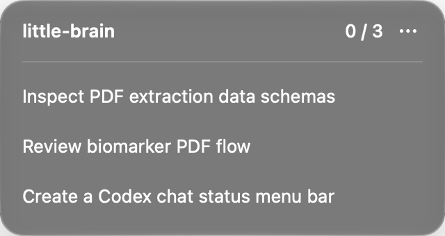

<picture>
  <source media="(prefers-color-scheme: dark)" srcset="docs/wordmark-dark.svg" />
  
</picture>

littlebrain tracks local Codex chats in the macOS menu bar. The counter shows finished chats with unread replies out of all tracked chats. A finished chat leaves the count when Codex marks it read. The panel lists chats under Ready for review or Running and shows side chats beneath their parents.



## Setup

Requires macOS 26 or later, Codex, and Xcode with the macOS 27 SDK or later.

Ask Codex:

> Install littlebrain from https://github.com/smol-ninja/little-brain on my Mac. Clone the repo, run ./build.sh, copy little-brain.app into /Applications, and launch it.

Or build it yourself:

```sh
git clone https://github.com/smol-ninja/little-brain.git
cd little-brain
./build.sh
cp -R ../little-brain.app /Applications/
open /Applications/little-brain.app
```

The panel has a Launch at login switch and a power button to quit.
