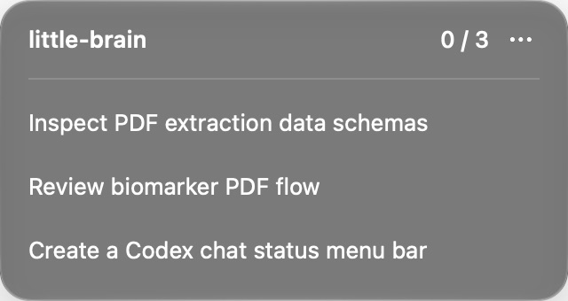

# little-brain

little-brain tracks active and unread Codex chats from the macOS menu bar. The counter shows finished unread chats out of all tracked chats. Opening a finished chat clears it.



## Setup

Requires macOS 26 or later, Codex, and Xcode with the macOS 26 SDK or later.

Ask Codex:

> Install little-brain from https://github.com/smol-ninja/little-brain on my Mac. Clone the repo, run ./build.sh, copy little-brain.app into /Applications, and launch it.

Or build it yourself:

```sh
git clone https://github.com/smol-ninja/little-brain.git
cd little-brain
./build.sh
cp -R ../little-brain.app /Applications/
open /Applications/little-brain.app
```

Use the options menu for Launch at login and Quit. little-brain tracks local Codex chats only.
